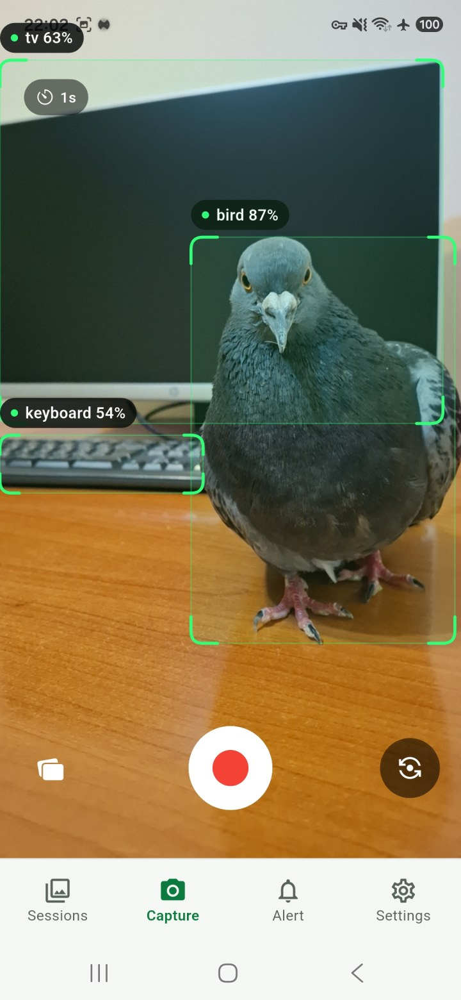
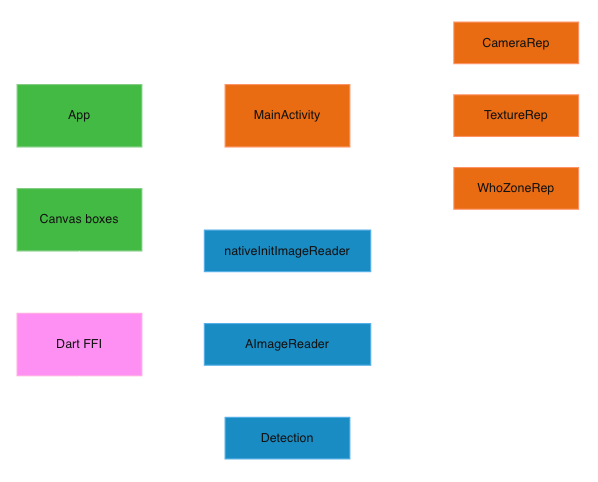

## WhoZone

This app serves as a playground for exploring YOLO11 models with practical application: point a phone at a scene, and it finds, tracks and logs what shows up, entirely on the device.<br>



## Features
* **Real-Time Object Detection**: YOLO11n at 320x320 on [ncnn](https://github.com/Tencent/ncnn), running on the big CPU cores. Output is identical to the ONNX model.
* **Native Surface Integration**: Camera frames reach C++ through `AImageReader` via JNI. Only the newest frame is processed, so results never fall behind the camera.
* **Object Tracking**: A **Kalman filter** per object keeps a stable identity, follows fast small objects, and ignores one-frame false positives.
* **Adaptive Rate**: 15 inferences per second while tracking, 8 on an empty scene. On a phone the limit is heat, not peak speed.
* **Event Bus**: Bidirectional communication between the native C++ engine and Flutter UI, serialized via **Protocol Buffers** and FFI.
* **UI**: Boxes follow each object by track id and animate at display rate, without rebuilding widgets.
* **Alerts**: Sound or a TCP/UDP packet on each capture event.

## Performance
Measured on a Samsung Galaxy A35 (Exynos 1380), model only, phone cool and idle:

| Engine | Inference | Model load |
|---|---|---|
| OpenCV DNN | 45-58 ms | 220 ms |
| ncnn, 4 threads | 25 ms | 52 ms |
| ncnn, 2 threads (used) | 34 ms | 69 ms |

Two threads are used on purpose: nearly the same speed for 2/3 of the energy, with big cores left for the camera and the UI.

## How to start
```bash
git clone https://github.com/khomin/WhoZone.git --recurse-submodule

./scripts/build_protobuf.sh android

./scripts/build_opencv.sh android

./scripts/build_ncnn.sh

flutter run --debug
```

## In case you want a model from scratch
```bash
cd ./resources
python3 -m venv yolo_env
source ./yolo_env/bin/activate
pip install --upgrade pip
pip install ultralytics
yolo export model=yolo11n.pt format=onnx imgsz=320 opset=17
cd ..
./scripts/convert_model.sh
```

## How to generate protobuf files
```bash
./scripts/gen_proto.sh
```

## How to update DI
```bash
dart run build_runner build
```

<a href="https://play.google.com/store/apps/details?id=com.who.zone">
  
</a>

## 📋 Prerequisites
Macos or Linux, Android studio with NDK